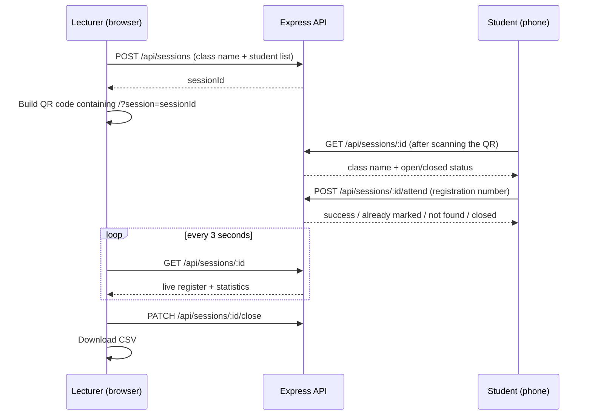
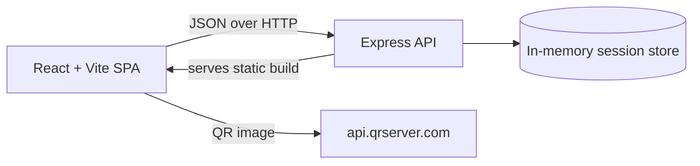

# AttendQR — QR Code Class Attendance System

> A lecturer shows a QR code. Students scan it, enter their registration number, and are marked present in seconds. No paper sheets, no proxy signing, and a live register for the lecturer.

Built as my Diploma Trade Project at the **Technical University of Mombasa** (Computer Science and Information Systems), then deployed to the cloud and tested with real phones.


---

## The problem

Attendance at my university is taken on paper sheets passed around the lecture hall. That costs lecture time, makes it easy for one student to sign for an absent friend, and leaves lecturers with paper records that are hard to total or search later.

AttendQR replaces the sheet with a QR code that only works while the lecturer keeps the session open.

## Features

| For lecturers | For students |
|---|---|
| Create a session from a class name and a pasted or uploaded CSV list | Scan the QR code with the normal phone camera |
| Unique QR code per session | Enter a registration number, nothing to install |
| Live register that refreshes every 3 seconds | Instant confirmation, or a clear error |
| Present / absent / percentage statistics | Duplicate scans are detected and handled |
| Close or reopen a session at any time | Works on any phone browser |
| One-click CSV download of the final register | |

## Screenshots

| Create a session | QR code card |
|---|---|
|  |  |

| Student view after scanning |
|---|
|  |

## How it works





## Tech stack

- **Frontend:** React 18, Vite
- **Backend:** Node.js, Express 4, `uuid`, `cors`
- **QR generation:** `api.qrserver.com` image API (chosen after a duplicate-React conflict with the `qrcode` npm package broke the app, see *Challenges*)
- **Deployment:** GitHub to Railway (Express serves the built React app, so one service runs everything)

## Project structure

```
Attendance-app/
├── Client/                 React + Vite frontend
│   ├── src/App.jsx         TeacherDashboard + StudentPage
│   ├── src/App.css
│   └── .env.example
├── Server/
│   └── index.js            Express API + static file hosting
├── docs/screenshots/
├── package.json            Root build/start scripts (used by the host)
└── sample-students.csv
```

## Run it locally

You need [Node.js 18+](https://nodejs.org).

```bash
# 1. Install and build the frontend
cd Client
npm install
npm run build
cd ..

# 2. Start the server (serves the API and the built app)
cd Server
npm install
npm start
```

Open **http://localhost:4000**.

For frontend development with hot reload, run `npm run dev` inside `Client` (port 3000, API calls are proxied to port 4000).

### Try it with a real phone

1. Put the laptop and the phone on the **same Wi-Fi**.
2. Find the laptop's IP (`ipconfig` on Windows, look for IPv4).
3. Allow the port through the firewall if the phone times out:
   `netsh advfirewall firewall add rule name="AttendQR" protocol=TCP dir=in localport=4000 action=allow`
4. On the **laptop**, open `http://<laptop-ip>:4000` (not `localhost`). The QR code uses the address you opened the app on, so the phone receives a link it can reach.
5. Create a session with `sample-students.csv`, scan the QR code, and enter `STU001`.

### Configuration

| Variable | Where | Purpose |
|---|---|---|
| `PORT` | Server | Port to listen on (default `4000`; hosts like Railway set this automatically) |
| `VITE_PUBLIC_URL` | Client (`.env`) | Optional override for the base URL stored in the QR code |

## API reference

| Method | Endpoint | Purpose |
|---|---|---|
| `GET` | `/api/health` | Health check |
| `POST` | `/api/sessions` | Create a session `{ className, students: [{ id, name }] }` |
| `GET` | `/api/sessions/:id` | Session details, register and summary |
| `POST` | `/api/sessions/:id/attend` | Mark attendance `{ studentId }` |
| `PATCH` | `/api/sessions/:id/close` | Stop accepting attendance |
| `PATCH` | `/api/sessions/:id/reopen` | Resume accepting attendance |

## Testing

A manual test plan of 8 cases covers valid attendance, unknown ID, duplicate scan, closed session, invalid session link, valid and invalid CSV, empty class name and report download. The full table is in the project report.

## Security decisions

- Only registration numbers on the lecturer's uploaded list can mark attendance
- Each student can mark once per session; repeats are reported, not recorded
- Closed sessions reject every submission
- IDs are normalised (trimmed, case-insensitive) before comparison
- Request body size, class name length and class size are capped
- HTTPS when deployed behind a host that terminates TLS

## Known limitations

I would rather state these than have you find them:

- **Data is in memory.** Restarting the server clears all sessions.
- **No lecturer login.** Anyone with the URL can create a session.
- **Typing an ID is not proof of presence.** A student could still share the link with a friend elsewhere; the QR code raises the effort, it does not remove the risk.
- **Polling, not WebSockets**, so the register can lag up to 3 seconds.

## Roadmap

- [ ] Persist sessions and attendance in PostgreSQL or SQLite
- [ ] Lecturer accounts with login (JWT)
- [ ] Rotating QR code and a time window to stop link sharing
- [ ] Per-student attendance history and low-attendance alerts
- [ ] Automated API tests with Jest and Supertest
- [ ] Replace the QR image API with client-side QR generation

## Challenges and what I learned

- **Two copies of React.** Adding the `qrcode` package produced an "Invalid hook call" crash. I traced it from the browser console to a duplicate dependency and switched QR generation to an API.
- **Local network vs the internet.** A QR code is only as good as the URL inside it. Hard-coding a Wi-Fi address broke scanning, so the URL now comes from the address the lecturer opened.
- **One service instead of two.** Having Express serve the built React app removed CORS problems and made deployment a single service.
- **Firewalls and ports.** Debugged `ERR_CONNECTION_TIMED_OUT` down to the Windows firewall.
- **Git hygiene.** Learned to keep `node_modules`, build output and binaries out of the repository.

## Author

**Kamanda Amos** — Computer Science diploma student, Technical University of Mombasa, with a focus on cybersecurity.
GitHub: [@Bandit17-Amoh](https://github.com/Bandit17-Amoh)

## License

MIT, see [LICENSE](LICENSE).
